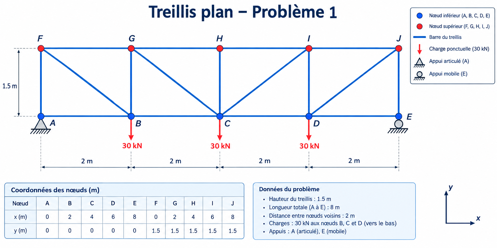

# 2D Parallel-Chord Truss Analysis with OpenSeesPy

[](https://www.python.org/)
[](https://openseespydoc.readthedocs.io/)
[](LICENSE)

A small educational Python project that models and performs a linear static analysis of a symmetric, 2D parallel-chord truss using OpenSeesPy. It reports support reactions, nodal displacements, member axial forces, and global force-equilibrium residuals, and creates a schematic of the geometry and loading.

## Structural configuration

The structure is a **symmetric, statically determinate, parallel-chord planar truss with vertical and inward-sloping diagonal members**. It is not intended to represent a conventional Warren truss.



### Geometry

- Number of nodes: 10
- Number of axial members: 17
- Span: 8.0 m
- Height: 1.5 m
- Panel width: 2.0 m
- Bottom chord: A–B, B–C, C–D, D–E
- Top chord: F–G, G–H, H–I, I–J
- Vertical members: A–F, B–G, C–H, D–I, E–J
- Diagonal members: F–B, G–C, J–D, I–C

### Supports and loading

- Node A: pinned support, with horizontal and vertical translations restrained.
- Node E: roller support, with vertical translation restrained and horizontal translation free.
- Downward point load: 30 kN at each of nodes B, C, and D.
- Total applied vertical load: 90 kN downward.

### Material and section assumptions

| Parameter | Value |
|---|---:|
| Young's modulus, $E$ | 210 GPa |
| Cross-sectional area, $A$ | $1.0 \times 10^{-3} \text{ m}^2$ |
| Material model | Linear elastic |
| Analysis | Linear static |

The material and section properties are illustrative assumptions, not verified design values.

## Features

- 2D OpenSeesPy model with `Truss` elements.
- Linear static analysis.
- Support reaction and nodal displacement reporting.
- Member axial force reporting, with tension positive and compression negative.
- Horizontal and vertical global force-equilibrium checks.
- Matplotlib schematic showing member connectivity, supports, and applied loads.

## Requirements

- Python 3.12 is the version indicated in the development environment; compatibility with other Python versions depends on the OpenSeesPy and Matplotlib releases available for that version.
- OpenSeesPy
- Matplotlib

## Installation and execution

1. Clone this repository:

   ```bash
   git clone https://github.com/Maglwe/Truss_analysis.git
   cd Truss_analysis
   ```

   Replace `YOUR_USERNAME` and `YOUR_REPOSITORY` with the actual GitHub username and repository name.

2. Create and activate a virtual environment (recommended):

   ```bash
   python -m venv .venv
   ```

   Windows PowerShell:

   ```powershell
   .\.venv\Scripts\Activate.ps1
   ```

   macOS/Linux:

   ```bash
   source .venv/bin/activate
   ```

3. Install dependencies:

   ```bash
   python -m pip install -r requirements.txt
   ```

4. Run the analysis script:

   ```bash
   python truss_analysis.py
   ```

The script prints the calculated results to the terminal, opens the structural schematic, and saves `truss_schema.png` beside the Python script.

## Model checks and limitations

For a planar truss, the determinacy count is

\[
m+r=2j
\]

where \(m\) is the number of members, \(r\) is the number of independent support restraints, and \(j\) is the number of joints. For this model, \(17+3=2(10)\). This count is necessary but by itself is not sufficient to establish stability; stability also depends on member geometry and connectivity.

The script checks global horizontal and vertical force equilibrium after analysis. These checks do not independently validate every modelling assumption or establish that the structure meets a design code.

This is an educational linear-elastic analysis. It does **not** include member self-weight, geometric or material nonlinearity, buckling checks, connection design, serviceability criteria, or code-compliance verification. Results should not be used for construction or safety-critical design without independent engineering review.

## Project files

```text
.
├── truss_analysis.py
├── truss_schema.png
├── README.md
├── requirements.txt
└── LICENSE
```

## License

This project is distributed under the MIT License. See [LICENSE](LICENSE).
